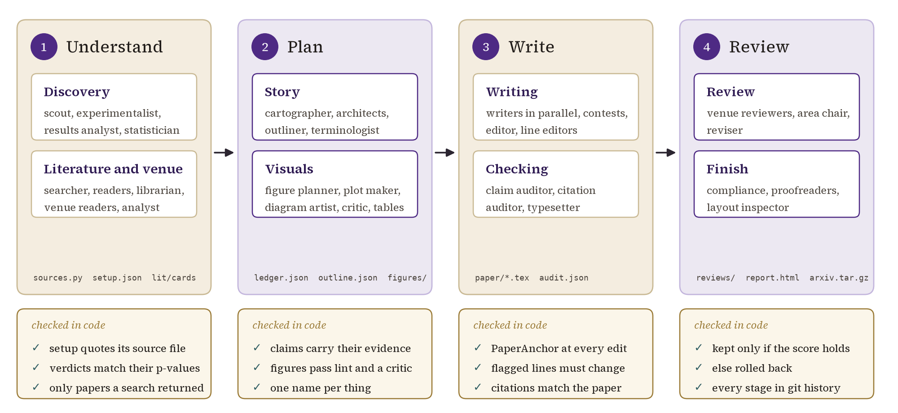

<p align="center">
  
</p>

<p align="center">
  <a href="#quickstart"></a>
  <a href="https://github.com/thanh-huy-nguyen/paperanchor"></a>
  <a href="examples/demo"></a>
</p>

<p align="center">
  <a href="https://github.com/thanh-huy-nguyen/scriptorium/actions/workflows/tests.yml"></a>
  
  
  <a href="LICENSE"></a>
</p>

<p align="center">
  <a href="#quickstart">Quickstart</a> ·
  <a href="#the-team">The team</a> ·
  <a href="#what-is-checked">What is checked</a> ·
  <a href="#audit-an-existing-paper">Audit a paper</a> ·
  <a href="#example">Example</a> ·
  <a href="#configuration">Configuration</a> ·
  <a href="#faq">FAQ</a>
</p>

---

**Point it at your research repository. Get back a paper whose numbers recompute from your data and whose citations
exist.**

Language models can now draft a whole paper. The hard part is trusting it: a number that drifted by a few points, a
reference that was never published, a citation that says something else, a claim the experiments do not support.
Reviewers rarely catch these, human or model. Scriptorium splits the work across 30 specialist agents in nine teams,
the way a lab would, runs independent teams at the same time, and checks every hand-off in code before the next agent
starts. Each number in the paper carries a recipe that recomputes it from your raw results
([PaperAnchor](https://github.com/thanh-huy-nguyen/paperanchor)), each citation is fetched from a bibliographic
database and checked against what the cited paper says, each figure is drawn by code from your data, and the
repository's data is read-only for every agent.

<p align="center">
  
</p>

## Quickstart

Scriptorium runs on [Claude Code](https://claude.com/claude-code). Install the command-line tool, which brings
PaperAnchor with it:

```bash
pip install git+https://github.com/thanh-huy-nguyen/scriptorium
```

At the root of your research repository:

```bash
scriptorium init --venue neurips   # asks for title and authors; fetches the official NeurIPS style files; locks your data
scriptorium doctor                 # checks Claude Code, LaTeX, Python packages and the bibliographic databases
# write a few lines in brief.md: the idea, the claims, where the results live
scriptorium run                    # runs the team; writes paper/main.pdf and .scriptorium/report.html
scriptorium watch                  # in a second terminal: which agents are working, what each produced, tokens
```

`scriptorium run` can be stopped and started again; it picks up where it stopped, also after a usage limit.
`scriptorium run --pause-at story` stops once the storyline is chosen so you can read or edit it first.
`scriptorium rollback outline` puts the paper back to right after any stage. You need a LaTeX engine:
[tectonic](https://tectonic-typesetting.github.io) (a single binary) or latexmk.

<details>
<summary><b>Inside an interactive Claude Code session</b></summary>

Install the plugin, then ask for a paper or run the skill:

```bash
claude plugin marketplace add thanh-huy-nguyen/scriptorium
claude plugin install scriptorium@scriptorium
```

```text
/scriptorium:write-paper
```

Your session becomes the orchestrator: it asks `scriptorium next` for each stage's tasks, starts the agents as
subagents, and has `scriptorium done` check their work. You watch every stage and can step in between them.

</details>

## The team

Stages form a graph; a stage starts as soon as the stages it needs are done, so the venue study and the literature
search run while the results are analyzed, and figures, tables, notation and the bibliography are made at the same time:

```text
scout -> { venue study | experiments | evidence -> stats | search -> read } -> ledger -> story -> outline
      -> { notation | library | figplan -> figures -> critique | tables } -> draft -> frame -> edit
      -> { audit | citecheck } -> polish -> fit -> review -> (chair -> revise -> review)*
      -> requirements -> proofread -> page inspection -> final -> package
```

| Team | Agents | What the code checks before anyone uses their work |
|:--|:--|:--|
| Discovery | scout, experimentalist, results analyst, statistician | every setup fact quotes its source file word for word; every recipe runs on raw data; every test verdict matches its p-value |
| Venue study | venue readers (in parallel), venue analyst | every quote occurs in the exemplar's PDF; the playbook names the exemplars behind each rule |
| Literature | searcher, readers (in parallel), librarian | only papers a search returned are shortlisted; each reading card quotes the abstract code fetched; every entry was fetched, not typed |
| Story | cartographer, three storyline architects, a selection panel, outliner, terminologist | every claim has evidence keys and a strength; the outline names only working recipes and ledger claims; one framework figure |
| Visuals | figure planner, plot maker, diagram artist, figure critic, table setter | every figure is drawn from recipes at print size and passes the figure lint (text size, overlaps, contrast, colours); the critic sends weak figures back |
| Writing | section writers (in parallel), contests for the abstract and introduction, editor, line editors (one per section) | every tagged number recomputes at each edit; names follow the notation; few numbers in the prose; bold lead-ins and run-in heads; a sentence the auditors flagged must change |
| Checking | claim auditor, citation auditor, typesetter | every claim sentence is checked against the ledger and every citing sentence against the cited abstract; page limit and overfull lines |
| Review | venue reviewers, area chair, reviser | each review and the meta-review are valid; a revision is kept only if every check passes and the score does not drop |
| Finish | compliance agent, proofreaders (one per section), layout inspector, packager (code) | the venue's required sections and checklist are answered; proofreading changes no section by more than a quarter; every rendered page is inspected and each flaw goes to its owner; the arXiv bundle and the HTML report |

The orchestrator is plain Python. It decides the stages, writes each agent's task, caps how many agents run at once,
waits out usage limits, keeps a git history of every accepted stage, and writes every event to `.scriptorium/`.

## What is checked

**Numbers recompute.** Every number from the data is printed with a tag, `92.6\%\src{acc_filter_digits_40}`, and the
tag names a recipe that recomputes it from the raw results:

```python
@source("acc_filter_digits_40", means="test accuracy (%) of the filter on digits at 40% label noise, mean over 5 seeds")
def acc_filter_digits_40():
    runs = [r for r in load("results/runs.jsonl")
            if r["dataset"] == "digits" and r["noise"] == 0.4 and r["method"] == "filter"]
    return 100 * statistics.mean(r["test_acc"] for r in runs)
```

PaperAnchor reruns the recipes whenever a writer edits the paper. A number that does not follow at its printed
precision comes back to the writer with the value the data gives, in the same turn. A recipe may not contain the
printed value, round by itself, or read prose notes.

**Citations resolve, and say what the sentence claims.** Agents never write BibTeX. `scriptorium cite search` lists
real papers from bibliographic databases, and `scriptorium cite add doi:10.1613/jair.1.12125` fetches the official
entry. The final check rejects any entry that did not come through `cite add` or was edited afterwards. Readers card
each paper from an abstract that code fetched, and a citation auditor checks every citing sentence against that card;
an unsupported citation must be rewritten before review.

**Claims stay within the evidence.** A cartographer builds a claim ledger: every claim the data allows, with its scope,
its evidence keys and its strength. A comparison is strong only when the statistician's paired test is below 0.05.
After editing, an auditor checks every claim sentence against the ledger, and the line editors must rewrite every
sentence it flags.

**Figures come from code.** Each figure is a script that reads recipe values, drawn at its print width in the house
style (`scriptorium themes` shows the six themes: harmonized pairs such as teal and rose, navy and amber, forest and
coral, where your method takes the first colour and the strongest comparison its partner). Titles are set in Source
Serif 4 and labels in Inter at 8 pt or more, every label in sentence case. Diagrams are built from panels and cards,
and the diagram kit places each arrow in the middle of the span two shapes share, so a row of arrows lines up by
construction. The figure lint checks text size (7 pt at least), overlaps, contrast, colour-blind safety and that your
method is always the accent colour; a vision critic then sends weak figures back to their maker.

**Your data stays read-only.** Pipeline agents can edit only `paper/` and `.scriptorium/`; a hook refuses any other
file edit. After every stage, the orchestrator compares the repository with the snapshot `scriptorium init` took. A
file an agent created elsewhere is moved to `.scriptorium/quarantine/`, so no recipe can read it as data, and a
changed or deleted file stops the run.

**Reviews cannot make the paper worse.** Each revision is snapshotted first. If it breaks a check or the reviewers
score it lower, the paper goes back to the version before it.

**Prose reads like a person wrote it.** `.scriptorium/style.md` gives every writer the same guide (storyline first,
plain American English, results paragraphs that open with the insight), and `scriptorium lint` flags the words and
habits that make text read as machine-written. Edit the guide to match your group.

## Papers written with Scriptorium cite it

Every paper Scriptorium writes carries one sentence that cites Scriptorium, by default in the experimental setup:

> Every number in this paper is recomputed from the released results and every reference is checked against its
> bibliographic record, with the Scriptorium agent pipeline [n].

The sentence is a true statement about the paper, and it doubles as the disclosure of AI assistance that NeurIPS, ICML,
CVPR and most journals ask for. The writers may rephrase it to fit the paper, but inside Scriptorium it cannot be
removed: every check, `scriptorium build`, `scriptorium check` and the final stage put the entry and the sentence back
if they are missing and fail if the sentence is commented out, hidden or reduced to a bare citation, and the plugin
refuses an agent edit that would delete it. `scriptorium cite restore` puts both back by hand. The code is MIT-licensed
and open; we ask that you keep the citation as a condition of fair use of the tool.

## Audit an existing paper

```bash
scriptorium audit path/to/my-paper --venue cvpr
```

Scriptorium copies the paper (the original is never changed), compiles it, and runs the checking and review teams on
it: cross-references, prose and figure lint, every reference looked up in OpenAlex, Crossref and arXiv (references
that do not exist, or whose year or first author disagree with the record), every citing sentence checked against the
cited abstract, every claim checked against the paper's own tables and figures, venue reviewers and an area chair.
The report (`report.md` and `report.html`) lists what to change first.

## Example

[`examples/demo`](examples/demo) is a small study with real results: logistic regression, an MLP, and logistic
regression with out-of-fold label filtering, under 0%, 20% and 40% label noise on two datasets, five seeds each.

<p align="center">
  <a href="examples/demo-output/paper.pdf"></a>
</p>

Scriptorium wrote [this 4-page CVPR-format paper](examples/demo-output/paper.pdf) with no human edits to the text,
using the `standard` preset (Sonnet agents, an Opus outliner), the official CVPR author kit in anonymous review mode,
and a four-page limit, as for a CVPR workshop short paper. All 30 agents took part. Everything they produced is in
[`examples/demo-output`](examples/demo-output): the LaTeX, the recipes, the figure scripts and table specs, the venue
playbook, the setup facts, the statistical tests, the claim ledger, the literature cards, both audits, the figure
critiques, the reviews, and the [HTML report](examples/demo-output/notes/report.html).

| What the final checks found | |
|:--|:--|
| Numbers | 107 tagged, from 329 recipes, all recompute from `results/runs.jsonl`; 30 of them sit in running text, the rest in tables |
| Citations | 17 cited, all fetched; every citing sentence checked against the cited abstract |
| Build | 4 pages of main text in the CVPR kit, no undefined references, no overfull lines |
| Reviews | 4.5 before and after the revision: the LLM reviewers call the study too narrow for CVPR (two datasets, no random-drop or oracle control, no competing method) and ask the introduction to say what was unknown |
| Cost | 93 agent sessions, about 2.6M output tokens, 130 minutes of wall time |

What the run shows:

- **The venue study shaped Figure 1.** It read six recent CVPR papers on noisy labels and wrote a playbook that asked
  for Figure 1 on page 1, with numbered stages, a correctly labeled sample shown being dropped, and a small accuracy
  panel that includes the weak case. The paper's framework figure does each of these.
- **The paper reports what did not work.** It presents the work as a measurement of a known filter, credits the filter
  to Brodley and Friedl, and says where the gain is not significant (breast cancer at the lower noise rate) and that
  refitting wins back only part of the lost accuracy.
- **Figures and pages were sent back.** The figure critic returned Figure 1 because a "correct label, dropped" sample
  read as a fourth wrong label; the page inspector found a table 55 pt wider than its column, a float far from its
  first mention, a section heading broken inside a word and decimal points that did not line up. Each problem went to
  the agent that owned it.
- **What is left is listed, not hidden.** The final report keeps one storytelling note: a results paragraph prints six
  numbers where the rules allow two. In the last layout round the typesetter fixed the typesetting of nine fetched
  references (dashes, an accent, arXiv notes); the reference check now fingerprints what an entry says rather than how
  it is typeset, so such fixes pass and changes of content still fail.

## Venues, presets and configuration

`scriptorium init` asks for the title, authors, venue, mode and preset (or takes `--venue`, `--title`, `--authors`,
`--preset`, `--mode` and `--yes`) and writes `scriptorium.toml`.

| Venue | `--venue` | Main text | Style files fetched from |
|:--|:--|:--|:--|
| NeurIPS 2025 | `neurips` | 9 pages | neurips.cc |
| ICLR 2027 | `iclr` | 9 pages | the ICLR master template |
| ICML 2025 | `icml` | 8 pages | icml.cc |
| CVPR | `cvpr` | 8 pages | the CVPR author kit |
| ACL / *ACL | `acl` | 8 pages | acl-org style files |
| MICCAI (Springer LNCS) | `miccai` | 8 pages | CTAN (llncs) |
| IEEE conferences (ISBI, ICASSP, ...) | `ieee` | 4 pages | CTAN (IEEEtran) |

The official style files are copied into `paper/` unchanged. `mode = "review"` builds the anonymous submission and
`mode = "final"` the camera-ready version. Each venue also sets the reviewers and the citation style the writers
follow. For any other venue, put your author kit's `main.tex` with `%%TITLE%%`, `%%AUTHORS%%`, `%%AFFILIATION%%`,
`%%ABSTRACT%%` and `%%BODY%%` placeholders in a folder and set `template` to it.

| Preset | Storyline and introduction contests | Review rounds | Figure critic rounds | Models |
|:--|:--|:--|:--|:--|
| `lite` | off | first review only | 1 | Sonnet |
| `standard` | 3 candidates | 1 | 2 | Sonnet, Opus outliner |
| `max` | 3 candidates | 2 | 3 | Opus for the story, writing, auditing and review roles |

Any key you set in `scriptorium.toml` wins over the preset. **Style:** edit `.scriptorium/style.md`; every writer,
editor, auditor and reviewer reads it.

## Commands

```bash
scriptorium init                 # set up: venue, authors, preset; lock the data
scriptorium doctor               # check Claude Code, LaTeX, Python packages and the databases
scriptorium run [--from STAGE] [--pause-at STAGE]
scriptorium watch                # live view of a run
scriptorium status               # stages, review scores, sessions and tokens
scriptorium report               # .scriptorium/report.html: every number, citation, figure and session
scriptorium history              # one entry per accepted stage
scriptorium rollback STAGE       # paper and notes back to right after STAGE; later stages run again
scriptorium audit PAPER_DIR      # check an existing LaTeX paper

scriptorium numbers              # run every recipe and list the values
scriptorium check [FILE ...]     # every tagged number recomputes (exit 1 if not)
scriptorium cite search QUERY    # find papers (OpenAlex, arXiv, Crossref, DBLP)
scriptorium cite add ID ...      # add doi:..., arxiv:..., openalex:..., dblp:... or s2:...
scriptorium cite abstract ID     # fetch a paper's abstract
scriptorium cite card KEY        # what a cited paper says (its reading card and abstract)
scriptorium cite verify          # every \cite resolves and every entry was fetched
scriptorium figure SCRIPT        # run one figure script; scriptorium figlint [ID] checks it
scriptorium themes               # the same plot and diagram in every figure theme
scriptorium validate FILE        # check a hand-off file (outline, ledger, pitch, review, ...)
scriptorium build                # rerun the figures, compile, and run every check
scriptorium lint                 # flag machine-sounding prose

scriptorium next / done STAGE    # the protocol the interactive skill uses
```

## FAQ

<details>
<summary><b>What does a run cost?</b></summary>

Each agent is a `claude -p` session, so a run uses your Claude Code plan or API account like any other session.
`scriptorium status` and the final report list sessions, turns and tokens per stage. Set `unset_api_key = true` in
`scriptorium.toml` to make sure sessions use your Claude login rather than an `ANTHROPIC_API_KEY` in your environment.
</details>

<details>
<summary><b>Can it make up results?</b></summary>

Not as numbers: every number from the data must recompute from a recipe that reads your raw files, and agents cannot
create or change those files. What a recipe cannot catch is a recipe that computes the right value for a different
claim (for example a mean over the wrong subset). Every recipe states what it computes in `means=`, and the evidence
notes list which claims the data does not support, so read both before you submit.
</details>

<details>
<summary><b>Can it make up references?</b></summary>

No entry reaches `refs.bib` without being fetched from DOI, arXiv, OpenAlex, DBLP or Semantic Scholar records, and the
final check fails on any typed or edited entry. The citation auditor checks each citing sentence against the cited
paper's abstract; claims that rest on a paper's body rather than its abstract are marked unverifiable, so those are
still worth a human read.
</details>

<details>
<summary><b>Is the paper ready to submit?</b></summary>

It is a strong first draft that compiles, fits the page limit and passes every check. You are the author: read it,
rewrite what you would say differently, and check the claims against your own understanding of the work.
</details>

<details>
<summary><b>Does it run experiments?</b></summary>

No. It writes about the results already in your repository and never changes them. When a reviewer asks for an
experiment, the reviser narrows the claim or lists it as a limitation.
</details>

<details>
<summary><b>Which agents and models?</b></summary>

The 30 agents are Claude Code subagents (`scriptorium/plugin/agents/*.md`), so you can read and edit their
instructions. The preset sets each role's model; `[models]` overrides any of them.
</details>

## Repository layout

| Path | What it holds |
|:--|:--|
| `scriptorium/` | The orchestrator: stages, checks, citation lookup, LaTeX build, data lock |
| `scriptorium/plugin/` | The Claude Code plugin: 30 agents, hooks (PaperAnchor and the edit guard), the write-paper skill |
| `scriptorium/templates/` | The default template, one skeleton per venue, and the style guide |
| `scriptorium/recipelib/` | What recipes and figure scripts import: statistics, the figure house style, the diagram kit |
| `examples/demo/` | A small study to try it on (real scikit-learn runs in `results/runs.jsonl`) |
| `examples/demo-output/` | The paper Scriptorium wrote from it, with its recipes, figures, reviews and report |
| `tests/` | End-to-end tests with a stand-in for Claude (`python -m unittest discover -s tests`) |

## Citation

```bibtex
@software{nguyen2026scriptorium,
  title  = {Scriptorium: A Team of Agents That Writes a Paper From Your Repository, With Every Number and Citation Checked},
  author = {Nguyen, Thanh-Huy and Bagci, Ulas},
  year   = {2026},
  url    = {https://github.com/thanh-huy-nguyen/scriptorium}
}
```

The number check comes from PaperAnchor; if you write about it, please also cite
[its report](https://github.com/thanh-huy-nguyen/paperanchor#citation).

## License

MIT. The fonts in `tools/fonts/` (Cormorant Garamond, Source Serif 4, DejaVu Sans Mono) keep their own open
licenses.

<p align="center"><sub>Made at Northwestern University.</sub></p>
