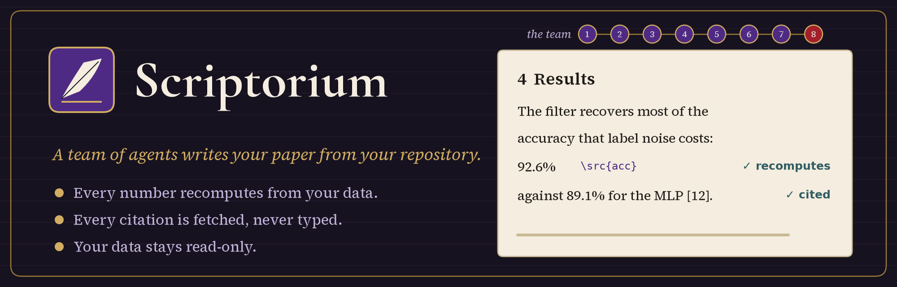
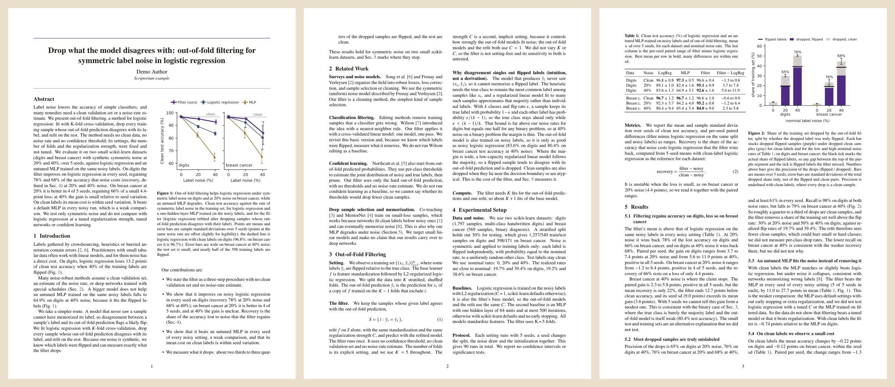

<p align="center">
  
</p>

<p align="center">
  <a href="#quickstart"></a>
  <a href="https://github.com/thanh-huy-nguyen/paperanchor"></a>
  <a href="examples/demo"></a>
</p>

<p align="center">
  <a href="https://github.com/thanh-huy-nguyen/scriptorium/actions/workflows/tests.yml"></a>
  
  
  <a href="LICENSE"></a>
</p>

<p align="center">
  <a href="#quickstart">Quickstart</a> ·
  <a href="#the-team">The team</a> ·
  <a href="#what-is-checked">What is checked</a> ·
  <a href="#example">Example</a> ·
  <a href="#configuration">Configuration</a> ·
  <a href="#faq">FAQ</a>
</p>

---

**Point it at your research repository. Get back a paper whose numbers recompute from your data and whose citations
exist.**

Language models can now draft a whole paper. The hard part is trusting it: a number that drifted by a few points, a
reference that was never published, a claim the experiments do not support. Reviewers rarely catch these, human or
model. Scriptorium splits the writing across a team of nine agents, the way a lab would, and checks every hand-off in
code. Each number in the paper carries a recipe that recomputes it from your raw results
([PaperAnchor](https://github.com/thanh-huy-nguyen/paperanchor)), each citation is fetched from a bibliographic
database instead of typed, and the repository's data is read-only for every agent.

<p align="center">
  
</p>

## Quickstart

Scriptorium runs on [Claude Code](https://claude.com/claude-code). Install the command-line tool, which brings
PaperAnchor with it:

```bash
pip install git+https://github.com/thanh-huy-nguyen/scriptorium
```

At the root of your research repository:

```bash
scriptorium init     # creates scriptorium.toml, brief.md and paper/, and locks your data as read-only
# write a few lines in brief.md: the idea, the claims, where the results live
scriptorium run      # runs the team headless; writes paper/main.pdf and .scriptorium/report.md
```

`scriptorium run` can be stopped and started again; it picks up at the first unfinished stage.
`scriptorium run --from outline` redoes the paper from a stage on. You need a LaTeX engine:
[tectonic](https://tectonic-typesetting.github.io) (a single binary) or latexmk.

<details>
<summary><b>Inside an interactive Claude Code session</b></summary>

Install the plugin, then ask for a paper or run the skill:

```bash
claude plugin marketplace add thanh-huy-nguyen/scriptorium
claude plugin install scriptorium@scriptorium
```

```text
/scriptorium:write-paper
```

Your session becomes the orchestrator: it asks `scriptorium next` for each stage's tasks, starts the agents as
subagents, and has `scriptorium done` check their work. You watch every stage and can step in between them.

</details>

## The team

| Agent | What it does | What the code checks after it |
|:--|:--|:--|
| Scout | Maps the repository: method, datasets, baselines, every result file and what its fields mean | The inventory exists |
| Evidence | Writes `paper/sources.py`, one recipe per number the paper may print, and says which claims in your brief the data does not support | Every recipe runs on raw data and returns a value |
| Outliner | Plans the storyline, sections, figures and related-work topics | The outline parses and names only numbers that have recipes |
| Librarian | Searches OpenAlex, arXiv, Crossref and DBLP, and adds papers with `scriptorium cite add` | Every entry was fetched, not typed, and is unchanged |
| Illustrator | Writes one script per figure that reads your data, renders it, looks at the image and fixes it | Every figure script reruns and produces its PDF |
| Writers | One per section, in parallel: method and results first, then abstract, introduction and related work | Every tagged number recomputes (PaperAnchor, at each edit); every `\cite` resolves |
| Editor | Makes the sections one paper, enforces the page limit, fixes the build and the prose lint | The paper compiles within the page limit |
| Reviewers | Score the paper as reviewers with different focuses (soundness, clarity, significance) | Each review is valid JSON with a score |
| Reviser | Answers the reviews; a point that needs a new experiment narrows the claim instead | The revision is kept only if every check passes and the mean score does not drop; otherwise it is rolled back |

The orchestrator is plain Python. It decides the stages, writes each agent's task, runs agents in parallel where
they do not depend on each other, and keeps every decision in `.scriptorium/`.

## What is checked

**Numbers recompute.** Every number from the data is printed with a tag, `92.6\%\src{acc_filter_digits_40}`, and the
tag names a recipe that recomputes it from the raw results:

```python
@source("acc_filter_digits_40", means="test accuracy (%) of the filter on digits at 40% label noise, mean over 5 seeds")
def acc_filter_digits_40():
    runs = [r for r in load("results/runs.jsonl")
            if r["dataset"] == "digits" and r["noise"] == 0.4 and r["method"] == "filter"]
    return 100 * statistics.mean(r["test_acc"] for r in runs)
```

PaperAnchor reruns the recipes whenever a writer edits the paper. A number that does not follow at its printed
precision comes back to the writer with the value the data gives, in the same turn. A recipe may not contain the
printed value, round by itself, or read prose notes.

**Citations resolve.** Agents never write BibTeX. `scriptorium cite search` lists real papers from bibliographic
databases, and `scriptorium cite add doi:10.1613/jair.1.12125` fetches the official entry. The final check rejects any
entry that did not come through `cite add` or was edited afterwards, and any `\cite` key with no entry.

**Your data stays read-only.** Pipeline agents can edit only `paper/` and `.scriptorium/`; a hook refuses any other
file edit. After every stage, the orchestrator compares the repository with the snapshot `scriptorium init` took. A
file an agent created elsewhere is moved to `.scriptorium/quarantine/`, so no recipe can read it as data, and a
changed or deleted file stops the run.

**Reviews cannot make the paper worse.** Each revision is snapshotted first. If it breaks a check or the reviewers
score it lower, the paper goes back to the version before it.

**Prose reads like a person wrote it.** `.scriptorium/style.md` gives every writer the same guide (storyline first,
plain American English, results paragraphs that open with the insight), and `scriptorium lint` flags the words and
habits that make text read as machine-written. Edit the guide to match your group.

## Example

[`examples/demo`](examples/demo) is a small study with real results: logistic regression, an MLP, and logistic
regression with out-of-fold label filtering, under 0%, 20% and 40% label noise on two datasets, five seeds each.

<p align="center">
  <a href="examples/demo-output/paper.pdf"></a>
</p>

Scriptorium wrote [this 4-page paper](examples/demo-output/paper.pdf) with no human edits to the text: one full pass
of 22 agent sessions and about 142k output tokens (Sonnet writers, an Opus outliner). We reran the stages from the
editor on once more after adding the American-spelling check, and the report in the folder counts both passes. Everything the team produced is in
[`examples/demo-output`](examples/demo-output): the LaTeX, the 127 recipes in `paper/sources.py`, the figure scripts,
the outline, the evidence notes, both rounds of reviews and the reviser's response.

| What the final checks found | |
|:--|:--|
| Numbers in the text | 182 tagged, all recompute from `results/runs.jsonl` |
| Citations | 9, all fetched (DOI, arXiv, OpenAlex); none typed |
| Build | 4 pages, no undefined references |
| Prose lint | no flags |

Three things in this run show what the checks are for:

- **The evidence agent narrowed the brief.** The brief claimed the filter "recovers most of the accuracy" lost to noise.
  The evidence notes found that it does on three of four noisy settings but not on the small binary dataset at 40%
  noise, and the paper says exactly that.
- **A blank number was caught in code.** The abstract's first draft used a macro that prints nothing in the PDF; the
  build check flagged both numbers and the reviser wrote them out.
- **The reviewers were not satisfied, and nothing was invented to satisfy them.** Both rounds scored 4.5 out of 10.
  The remaining points ask for stronger baselines and more datasets, which the repository does not have, so the
  reviser narrowed the claims and listed the missing comparisons as limitations instead.

## Configuration

`scriptorium init` writes `scriptorium.toml`:

```toml
[paper]
title = "Working title"
authors = ["First Author", "Second Author"]
venue = "workshop"            # shown to the agents
page_limit = 8                # main text, references excluded
template = "default"          # or a folder with your venue's main.tex

[models]                      # sonnet | opus | haiku | a full model id
default = "sonnet"
outliner = "opus"             # the storyline matters most
reviewer = "sonnet"

[run]
review_rounds = 1
reviewers = ["soundness", "clarity", "significance"]
parallel = 4
check_mode = "feedback"       # PaperAnchor: feedback after each edit, or gate (refuse the edit)
```

**Venue templates.** Copy your venue's author kit into a folder, put `%%TITLE%%`, `%%AUTHORS%%`, `%%AFFILIATION%%`,
`%%ABSTRACT%%` and `%%BODY%%` where those belong in its `main.tex`, and set `template` to that folder. The other files
in the folder (`.sty`, `.bst`) are copied next to the paper.

**Style.** Edit `.scriptorium/style.md`. Every writer, the editor, the reviewers and the reviser read it.

## Commands

```bash
scriptorium init                 # set up the project and lock the data
scriptorium run [--from STAGE]   # run the remaining stages headless
scriptorium status               # stages, review scores, sessions and tokens
scriptorium reset STAGE          # mark a stage and every later one as not done

scriptorium numbers              # run every recipe and list the values
scriptorium check [FILE ...]     # every tagged number recomputes (exit 1 if not)
scriptorium cite search QUERY    # find papers (OpenAlex, arXiv, Crossref, DBLP)
scriptorium cite add ID ...      # add doi:..., arxiv:..., openalex:..., dblp:... or s2:...
scriptorium cite verify          # every \cite resolves and every entry was fetched
scriptorium figure SCRIPT        # run one figure script from the repository root
scriptorium build                # rerun the figures, compile, and run every check
scriptorium lint                 # flag machine-sounding prose

scriptorium next / done STAGE    # the protocol the interactive skill uses
```

## FAQ

<details>
<summary><b>What does a run cost?</b></summary>

Each agent is a `claude -p` session, so a run uses your Claude Code plan or API account like any other session.
`scriptorium status` and the final report list sessions, turns and tokens per stage. Set `unset_api_key = true` in
`scriptorium.toml` to make sure sessions use your Claude login rather than an `ANTHROPIC_API_KEY` in your environment.
</details>

<details>
<summary><b>Can it make up results?</b></summary>

Not as numbers: every number from the data must recompute from a recipe that reads your raw files, and agents cannot
create or change those files. What a recipe cannot catch is a recipe that computes the right value for a different
claim (for example a mean over the wrong subset). Every recipe states what it computes in `means=`, and the evidence
notes list which claims the data does not support, so read both before you submit.
</details>

<details>
<summary><b>Can it make up references?</b></summary>

No entry reaches `refs.bib` without being fetched from DOI, arXiv, OpenAlex, DBLP or Semantic Scholar records, and the
final check fails on any typed or edited entry. Whether a cited paper says what the sentence claims is still worth a
human read.
</details>

<details>
<summary><b>Is the paper ready to submit?</b></summary>

It is a strong first draft that compiles, fits the page limit and passes every check. You are the author: read it,
rewrite what you would say differently, and check the claims against your own understanding of the work.
</details>

<details>
<summary><b>Does it run experiments?</b></summary>

No. It writes about the results already in your repository and never changes them. When a reviewer asks for an
experiment, the reviser narrows the claim or lists it as a limitation.
</details>

<details>
<summary><b>Which agents and models?</b></summary>

The agents are Claude Code subagents (`scriptorium/plugin/agents/*.md`), so you can read and edit their
instructions. Each role's model is set in `[models]`.
</details>

## Repository layout

| Path | What it holds |
|:--|:--|
| `scriptorium/` | The orchestrator: stages, checks, citation lookup, LaTeX build, data lock |
| `scriptorium/plugin/` | The Claude Code plugin: nine agents, hooks (PaperAnchor and the edit guard), the write-paper skill |
| `scriptorium/templates/` | The default paper template and the style guide |
| `examples/demo/` | A small study to try it on (real scikit-learn runs in `results/runs.jsonl`) |
| `examples/demo-output/` | The paper Scriptorium wrote from it, with its recipes, figures, reviews and report |
| `tests/` | End-to-end tests with a stand-in for Claude (`python -m unittest discover -s tests`) |

## Citation

```bibtex
@software{nguyen2026scriptorium,
  title  = {Scriptorium: A Team of Agents That Writes a Paper From Your Repository, With Every Number and Citation Checked},
  author = {Nguyen, Thanh-Huy and Bagci, Ulas},
  year   = {2026},
  url    = {https://github.com/thanh-huy-nguyen/scriptorium}
}
```

The number check comes from PaperAnchor; if you write about it, please also cite
[its report](https://github.com/thanh-huy-nguyen/paperanchor#citation).

## License

MIT. The fonts in `tools/fonts/` (Cormorant Garamond, Source Serif 4, DejaVu Sans Mono) keep their own open
licenses.

<p align="center"><sub>Made at Northwestern University.</sub></p>
